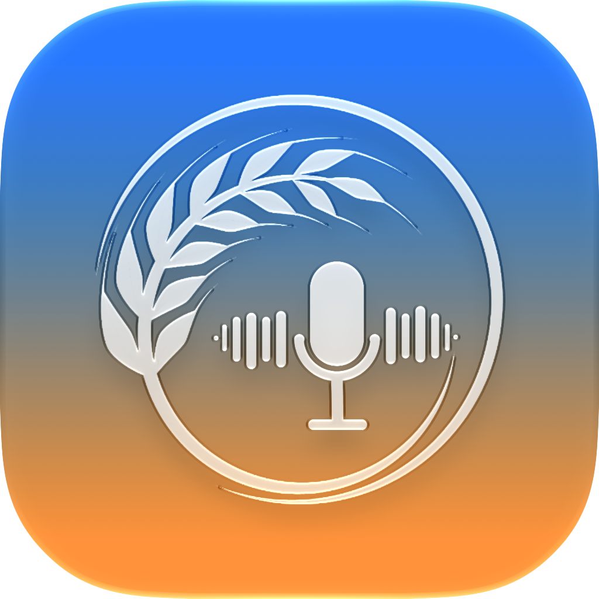

# Oatmeal

A tiny, private macOS app that records a 1:1 call — your voice and the other
side's voice — and transcribes it **entirely on your Mac** into a **plain
Markdown file**, every line labeled `You` or `Them`.

No cloud, no account, no LLM on your behalf. The transcript stays on your
machine.

---

## Recording Consent & Legal Disclaimer

**Important:** Oatmeal records and transcribes audio from your microphone and
system audio. Many jurisdictions have laws requiring consent from some or all
participants before a conversation may be recorded (e.g., two-party/all-party
consent states in the U.S., GDPR in the EU).

By using this software, you acknowledge and agree that:

- You are **solely responsible** for determining whether recording is lawful in
  your jurisdiction and for obtaining any required consent from all participants
  before starting a session.
- The developers and contributors of Oatmeal provide no legal advice and make no
  representations about the legality of recording in any jurisdiction.
- The developers accept no liability for any unauthorized or unlawful recording
  conducted using this software.
- **Do not use this software** to record conversations without proper consent
  where required by law.

---

## Get the app

Download **Oatmeal-<version>.dmg**, then:

1. **Open the DMG** — a volume named **Oatmeal** mounts.
2. **Drag `Oatmeal.app` into the Applications** shortcut.
3. **Launch** it from your **menu bar** (top-right of your screen — it has no
   Dock icon).
4. **Grant two permissions** when prompted (Microphone + System Audio) so it can
   hear both sides of the call.

That's it. The app lives in your menu bar.

> **First launch:** this build isn't notarized, so macOS may say it "can't be
> opened". Fix it once: **right-click `Oatmeal.app` → Open → Open**.

<b>Where do I get the DMG?</b>

The DMG is produced from the repo with `./packaging/make_dmg.sh` (see the
[technical guide](docs/installing.md#2-building-the-dmg-from-source)). When a
release is published, the download link goes here.

---

## Use it

- **Start Recording** before a call — it records your mic (You) and the other
  person's voice through your speakers (Them).
- **Stop Recording & Transcribe** after — it transcribes both sides **on your
  Mac** and writes a clean Markdown file to `~/Meetings/transcripts/`.
- A **notification** pops up when the transcript is ready.

You also get: **Change Storage Location…** (where recordings/transcripts go),
**Open Folder ▸ Recordings / Transcripts**, **Check Active Transcriptions…**, and
**Start Recording from Calendar…** (attaches the meeting title, attendees, and
notes to the recording).

### A few things to know

- **Private by default.** Recording, transcription, and the transcript all stay
  on your Mac.
- **Your format.** Plain Markdown — drop it into an Obsidian vault or point your
  agent at the folder. No lock-in.
- **Which permissions and why.** See the [permissions
  quick-guide](docs/installing.md#7-permissions). If a track comes out silent,
  a permission is usually denied — see [docs/permissions-troubleshooting.md](docs/permissions-troubleshooting.md).
- **Where files land.** `~/Meetings/recordings/<stamp>/` (WAVs + meta) and
  `~/Meetings/transcripts/<stamp>.md` — see [Output
  layout](docs/installing.md#8-output-layout).

---

## For technical folks

The full reference lives in **[docs/installing.md](docs/installing.md)** —
a technical deep dive covering:

- **Build the DMG from source** (`./packaging/make_dmg.sh`) — §2
- **Install & use the `mr` CLI** from a source checkout — §3
- **The complete `mr` CLI reference** (`toggle`/`start`/`stop`/`status`/`process`/`doctor`)
  and exit codes — §4
- **Configuration** (`~/.config/mr/config.toml`) — §5
- **Bind `mr toggle` to a hotkey** (Shortcuts / Raycast) — §6
- **Permissions deep-dive** — §7
- **Output layout** — §8
- **Meeting context & Obsidian frontmatter (calendar)** — §9
- **The `Oatmeal` menu-bar app** (build/install) — §10
- **Project layout & development** — §11

---

## What this is and why

I built this to solve a small problem of my own: meeting-summary apps are packed
with features I never asked for, and the summaries they produce are only as good
as the context behind them. A summary only "sees" the meeting; the person who
actually has context is **you** — your notes, memory, and vault.

So Oatmeal does one deliberately small thing well: it captures a faithful,
clearly-attributed transcript of a 1:1 call and hands the thinking to **your own
agent** (or your own review), where the real context lives.

- **Private by default.** Everything local.
- **Your format.** Plain Markdown, no lock-in.
- **Built for your workflow.** A raw conversation your agent can sort through
  with the context only you (and it) have.

## License

See [LICENSE](LICENSE).