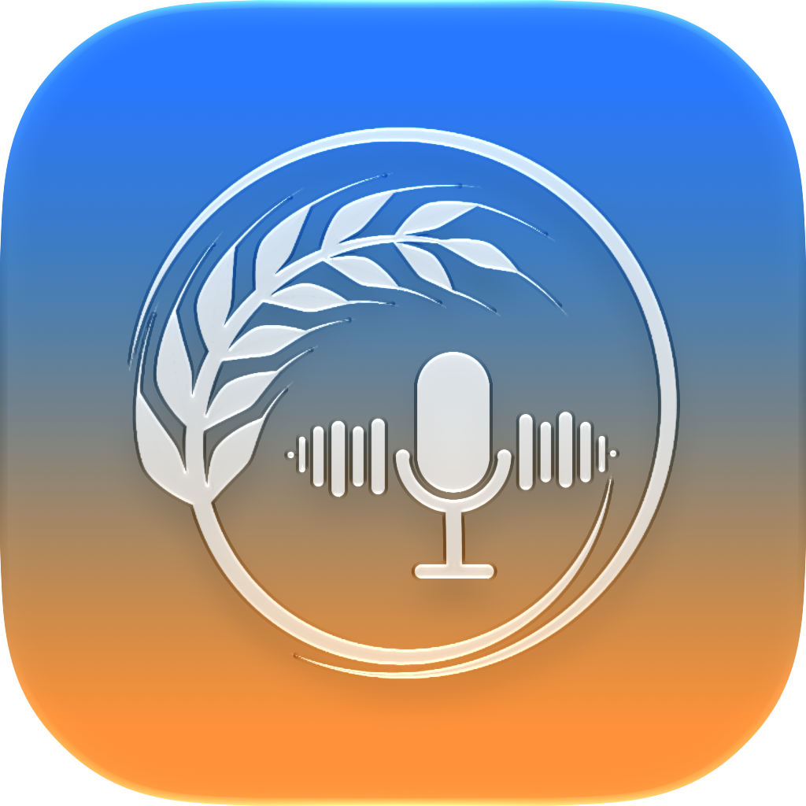

<p align="center">
  
</p>

<h1 align="center">Oatmeal</h1>

<p align="center">
  A tiny, private macOS menu-bar app that records your calls and turns them into
  a clean Markdown transcript, <b>entirely on your Mac</b>.
</p>

---

## What it does

- **Records both sides of a call:** your microphone and the audio coming out of
  your speakers (Zoom, Teams, Meet, a phone call on your Mac, anything).
- **Transcribes it on your Mac** with a local speech model. No cloud, no
  account, no upload.
- **Tells you who said what.** Your lines are labelled `You`. The other side is
  split into `Speaker 1`, `Speaker 2`, ... so a group call reads like a real
  conversation, not one long block.
- **Writes a plain Markdown file** you can read, search, drop into Obsidian, or
  hand to your own AI assistant.

A transcript looks like this:

```markdown
- **Participants:** You (mic), Speaker 1, Speaker 2 (system)

**Speaker 1 (02:13):** Can you assign someone to support this?

**Speaker 2 (02:21):** It'll likely be Vinit, but I'll check his plate first.

**You (02:26):** Sounds good, loop me in on that chat.
```

---

## Recording consent & legal disclaimer

**Important:** Oatmeal records and transcribes audio from your microphone and
system audio. Many jurisdictions have laws requiring consent from some or all
participants before a conversation may be recorded (e.g., two-party/all-party
consent states in the U.S., GDPR in the EU).

By using this software, you acknowledge and agree that:

- You are **solely responsible** for determining whether recording is lawful in
  your jurisdiction and for obtaining any required consent from all participants
  before starting a session.
- The developers and contributors of Oatmeal provide no legal advice and make no
  representations about the legality of recording in any jurisdiction.
- The developers accept no liability for any unauthorized or unlawful recording
  conducted using this software.
- **Do not use this software** to record conversations without proper consent
  where required by law.

---

## Before you start

You need:

- A Mac with **Apple Silicon** (M1 or newer).
- **macOS 14.2** or later.
- About 4 GB of free disk space for the speech models (downloaded once).
- An internet connection **once**, to download those models. After that,
  Oatmeal works fully offline.

---

## Install (about 5 minutes)

### 1. Install the app

1. Download **`Oatmeal-<version>.dmg`** from the
   [latest release](https://github.com/avsabhinav/meeting_recorder/releases/latest)
   and double-click it.
2. Drag **`Oatmeal.app`** onto the **Applications** shortcut in the window that
   opens.
3. Eject the disk image.

> **"Oatmeal can't be opened"?** This build isn't notarized by Apple yet, so
> macOS blocks the very first launch. Fix it once: in **Applications**,
> **right-click `Oatmeal.app` → Open → Open**. Normal launches work after that.

### 2. Download the speech models (one time)

Open **Terminal** (press `⌘ Space`, type *Terminal*, press Return) and paste:

```bash
/Applications/Oatmeal.app/Contents/Resources/mr-cli/mr-cli doctor --fetch-model
```

This downloads the transcription model (about 3 GB) and the speaker-separation
model (about 400 MB) into your local model cache. It can take a few minutes.
When it finishes, it prints a `fetched ...` line for each model. To double-check,
run the same command again: it should show `model cached: yes` and
`diarization model cached: yes`. You can close Terminal.

> It may also print `helper: MISSING`. That's expected when run from Terminal:
> the app supplies its recording helper itself.

### 3. Launch and allow two permissions

Open **Oatmeal** from Applications. It has **no Dock icon**: look for its icon
in the **menu bar** at the top-right of your screen.

The first time you record, macOS asks for two permissions. Allow both:

- **Microphone**: to hear you.
- **System Audio Recording**: to hear the other side of the call.

That's it, you're set up.

<details>
<summary><b>Where do I get the DMG?</b></summary>

From the [Releases page](https://github.com/avsabhinav/meeting_recorder/releases/latest).
Each release also lists the DMG's SHA-256 checksum. You can build it yourself
with `./packaging/make_dmg.sh` (see the
[technical guide](docs/installing.md#2-building-the-dmg-from-source)).
</details>

---

## Use it

### Record a call

1. Click the Oatmeal icon in the menu bar and choose **Start Recording** just
   before your call. (Or **Start Recording from Calendar...** to attach the
   meeting's title, attendees and notes.)
2. Have your call as usual.
3. When it's over, choose **Stop Recording & Transcribe**.
4. Oatmeal transcribes in the background. You can start another recording right
   away. A **notification** appears when the transcript is ready; click it to
   open the file.

Transcripts go to `~/Meetings/transcripts/`. Use **Open Folder ▸ Transcripts**
to get there, or **Change Storage Location...** to put them somewhere else.

### Other things in the menu

- **Check Active Transcriptions...**: see what's being transcribed. If one is
  taking too long, **Stop Transcription** cancels it (you'll be asked to
  confirm).
- **Re-transcribe...**: run transcription again on a past recording, for
  example after an update. Recordings whose audio was deleted show as
  unavailable.
- **Open Folder ▸ Recordings / Transcripts**: jump to your files in Finder.

### How speaker labels work

- **`You`** is always your microphone.
- **`Speaker 1`, `Speaker 2`, ...** are the other voices on the call, numbered
  in the order they first speak. Oatmeal tells voices apart, but it doesn't
  know names, so `Speaker 1` in one meeting isn't the same person as
  `Speaker 1` in another.
- If speaker separation can't run (for example, its model isn't downloaded),
  you still get a full transcript. The other side is simply labelled `Them`.
- Want one `Them` label instead? Add `diarize = false` to
  `~/.config/mr/config.toml`.

---

## If something goes wrong

| What you see | What to do |
| --- | --- |
| macOS says Oatmeal "can't be opened" | Right-click `Oatmeal.app` → **Open** → **Open** (once). |
| One side of the call is missing or silent | A permission is usually off. Check **System Settings → Privacy & Security → Microphone** and **System Audio Recording**, then see [permissions troubleshooting](docs/permissions-troubleshooting.md). |
| The other side is all `Them`, not `Speaker 1/2/...` | The speaker model isn't downloaded. Run step 2 of the install again. |
| A transcript never shows up | Look in the transcripts folder for a `<stamp>.FAILED.md` note; it explains what happened and how to retry. You can also use **Re-transcribe...**. |

---

## Private by design

- **Everything stays on your Mac:** the audio, the transcription and the
  transcript. Nothing is uploaded.
- **No AI summaries on your behalf.** Oatmeal produces a faithful, attributed
  transcript. What you do with it is up to you.
- **No lock-in.** Plain Markdown files in a folder you choose.

Files live in `~/Meetings/recordings/<stamp>/` (the audio) and
`~/Meetings/transcripts/<stamp>.md` (the transcript). See
[Output layout](docs/installing.md#8-output-layout) for details.

---

## For technical folks

The full reference lives in **[docs/installing.md](docs/installing.md)**:

- Build the DMG from source (`./packaging/make_dmg.sh`): §2
- Install and use the `mr` CLI from a source checkout: §3
- The complete `mr` CLI reference and exit codes: §4
- Configuration (`~/.config/mr/config.toml`), including `diarize` and
  `diarization_model`: §5
- Bind `mr toggle` to a hotkey (Shortcuts / Raycast): §6
- Permissions deep-dive: §7
- Output layout: §8
- Meeting context & Obsidian frontmatter (calendar): §9
- The Oatmeal menu-bar app (build/install): §10
- Project layout & development: §11

Under the hood: transcription uses
[Whisper large-v3-turbo](https://huggingface.co/mlx-community/whisper-large-v3-turbo)
and speaker separation uses
[NVIDIA Nemotron 3 Diarization](https://huggingface.co/mlx-community/Nemotron-3-Diarization),
both running locally on Apple's MLX framework. See
[docs/architecture.md](docs/architecture.md) for the design.

---

## What this is and why

I built this to solve a small problem of my own: meeting-summary apps are packed
with features I never asked for, and the summaries they produce are only as good
as the context behind them. A summary only "sees" the meeting; the person who
actually has context is **you**: your notes, memory, and vault.

So Oatmeal does one deliberately small thing well: it captures a faithful,
clearly attributed transcript of a call and hands the thinking to **your own
agent** (or your own review), where the real context lives.

## License

See [LICENSE](LICENSE).
